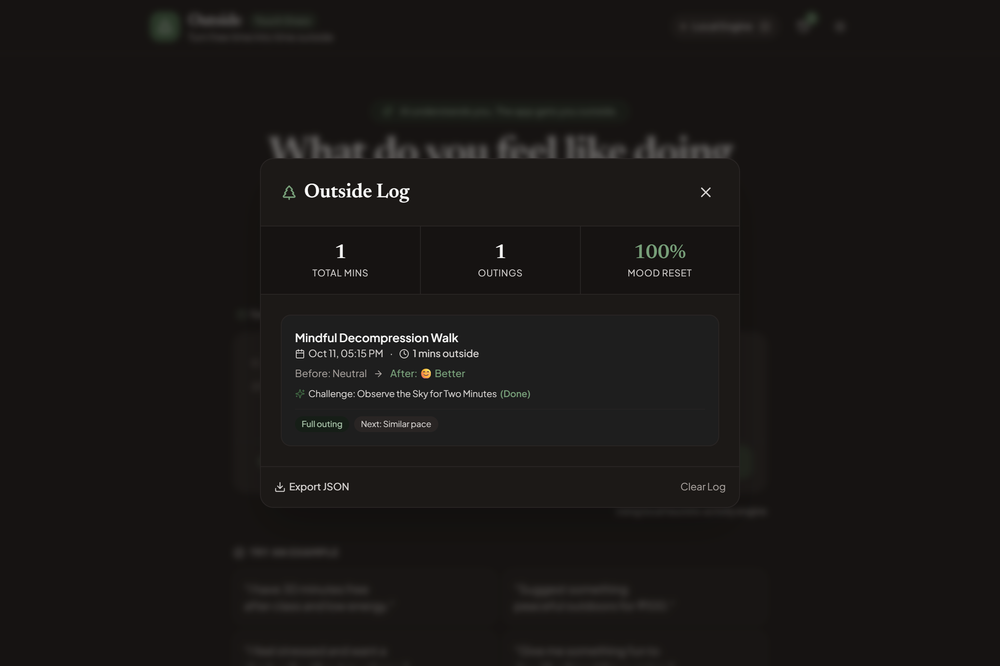

<div align="center">

# Outside 🌿
### *Touch Grass. Find Your Next Adventure.*

**An open-source outdoor activity companion powered by local open-weight AI, engineered to minimize screen time and maximize real-world experiences.**

Built for the **DEV Hacktoberfest 2026** Week 1 Challenge: **“Touch Grass.”**

[](LICENSE)
[](https://react.dev/)
[](https://www.typescriptlang.org/)
[](https://vitejs.dev/)
[](https://tailwindcss.com/)
[](https://ai.google.dev/gemma)
[](https://ollama.com/)
[](tests/)

[Quick Start](#-quick-start) • [The Philosophy](#-why-outside-exists) • [Core Features](#-core-features) • [Architecture](#-ai-architecture--system-design) • [HF26 Sponsors](#-hf26-sponsors--technology-acknowledgements) • [Documentation](docs/)

<br />


</div>

---

## 📖 Table of Contents

- [Why Outside Exists](#-why-outside-exists)
- [How It Works](#-how-it-works)
- [Visual Product Tour](#-visual-product-tour)
- [Core Features](#-core-features)
- [AI Architecture & System Design](#-ai-architecture--system-design)
- [HF26 Sponsors & Technology Acknowledgements](#-hf26-sponsors--technology-acknowledgements)
- [Technology Stack](#-technology-stack)
- [Quick Start](#-quick-start)
- [Running Gemma Locally with Ollama](#-running-gemma-locally-with-ollama)
- [Testing & Verification](#-testing--verification)
- [Deployment Guide](#-deployment-guide)
- [Project Roadmap](#-project-roadmap)
- [Contributing](#-contributing)
- [License](#-license)

---

## 💡 Why Outside Exists

### The Modern Dilemma
Most technology products are engineered to capture attention, maximize daily active time, and trap users inside glowing glass rectangles. Even modern "mindfulness" and "wellness" applications frequently fall into this trap: they ask you to log daily streaks, read articles, scroll activity feeds, or have multi-turn conversations with chatbots.

**Outside takes the opposite approach.** Its primary success metric is **how quickly you put your phone away and step into the open air.**

> **“AI understands you. The app gets you outside.”**

```
Tell Outside how you feel ➔ Receive one achievable mission ➔ Put phone away ➔ Experience the real world ➔ Reflect
```

### Outside vs. Traditional Apps

| Capability | Traditional Wellness & Habit Apps | Outside 🌿 |
| :--- | :--- | :--- |
| **Primary Goal** | Maximize screen time, retention, and DAUs | **Minimize screen time; maximize time spent outside** |
| **AI Role** | Open-ended chatbots keeping you on the screen | **Single-turn structured parameter extraction** |
| **Itinerary Generation** | Hallucinates unrealistic routes & timing | **Deterministic engine with real-world clock timestamps** |
| **Real-World Changes** | Forces you to restart the flow from scratch | **1-click "Plans Changed?" dynamic recalibration** |
| **Privacy & Telemetry** | Heavy cloud logging, ads, and telemetry | **100% on-device (Ollama + browser localStorage)** |

---

## 🧭 How It Works

Outside breaks down the friction between intending to go outside and actually stepping through the door:

1. **Describe Your Situation Naturally**: Type or click a natural prompt:
   > *“I have 90 minutes free this evening. I don't want to spend money and I want something relaxing.”*
2. **Local Open-Weight AI Comprehension**: Google Gemma (`gemma2:2b`) parses your natural language into strict, typed constraints—duration, energy level, budget, mood, and social preferences.
3. **Deterministic Mission Construction**: A verified scheduling engine converts these parameters into a clock-based timeline (e.g. *6:00 PM Departure*, *6:05 PM Outbound stroll*, *6:35 PM Mindful observation*, *7:00 PM Sensory pause*, *7:15 PM Stroll home*), alongside preparation checklists and sensory micro-challenges.
4. **Distraction-Free Screen Exit Mode**: Click **"Start Outside Time 🌿"**. The interface sheds menus, cards, and web clutter, presenting only a calm countdown, milestone instruction, and ambient audio singing bowl bell.
5. **Mindful Return & Local Log**: Return inside, record your mood shift (😊 *Better*, 😌 *Relaxing*, ⚡ *Energizing*), and save your session locally on-device.

---

## 📸 Visual Product Tour

<div align="center">

| **1. Natural-Language Input** | **2. Structured Outdoor Plan** |
| :---: | :---: |
|  |  |
| *Express constraints naturally with zero menu friction* | *Clock-based timeline, items to bring, and sensory task* |
| **3. Minimalist Screen Exit Mode** | **4. Local Wellbeing Log** |
|  |  |
| *Minimal ambient timer with singing bowl chimes* | *100% local persistence with mood shift tracking* |

</div>

> 🔍 **Judges & Evaluators**: A complete, step-by-step 2-minute demonstration walkthrough is available in [`docs/demo-script.md`](docs/demo-script.md).

---

## ✨ Core Features

### 1. Natural-Language Mission Generation
- Understands freeform input covering time, mood, budget, energy, and companions:
  - *“I have 30 minutes free after class and low energy.”*
  - *“Suggest something peaceful outdoors for ₹100.”*
  - *“I feel stressed and want a short walk without my phone.”*
  - *“Give me something fun to do with a friend this evening.”*
- Zero multi-turn chat loops; delivers one focused, actionable mission immediately.

### 2. Local AI Inference with Google Gemma
- Connects out of the box to local OpenAI-compatible endpoints (default: `http://localhost:11434/v1/chat/completions` running `gemma2:2b`).
- AI extracts parameters only; it never hallucinates physical trail lengths or dangerous timing.

### 3. Transparent AI Connection Diagnostics
- In-app **AI Engine & Privacy** modal with a live **Test Connection** button.
- Sends a minimal health ping (`max_tokens: 5`) to confirm model presence in memory.
- Measures real roundtrip latency (e.g. `Connected (1253ms) — gemma2:2b verified`).
- Configured with a realistic **30-second timeout** accommodating local consumer CPU/GPU inference.

### 4. Zero-Crash Deterministic Heuristic Fallback
- If Ollama is offline or takes longer than the timeout, Outside activates an internal deterministic heuristic engine (regex and semantic extraction).
- Displays an honest `Local Engine` badge—**never fakes AI responses and never crashes**.

### 5. "Plans Changed?" Real-World Mission Adaptation
Real life is unpredictable. If weather turns or energy drops, click **"Plans changed?"** to adapt the active mission on the fly:
- **Available Time**: Quickly adjust to 15m, 30m, 45m, or 60m.
- **Energy Level**: Switch between Exhausted / Low, Moderate, or Energized.
- **Weather & Shelter**: Swaps open trails for covered porches, gazebo lookouts, or sheltered canopy paths.
- **Step-Free Accessibility**: Filters for flat, paved, stair-free routes with nearby seating.
- **Social Mode**: Toggles between solo quiet time and walking with friends.

### 6. "Challenge Me" Sensory Micro-Challenges
Tactile exercises designed to break digital autopilot and stimulate sensory grounding:
- *5-Senses Grounding* (Sight, touch, sound, smell, presence)
- *Canopy & Cloud Gaze* (Looking upward away from screens)
- *Three Leaf Architectures* (Observing biological fractal patterns)
- *Five Minutes Without Headphones* (Acoustic horizon listening)
- Includes difficulty ratings, completion actions, reflection prompts, and a shuffle button.

### 7. Distraction-Free Screen Exit Mode ("GO OUTSIDE")
- High-contrast, battery-friendly ambient interface.
- Large countdown timer with active milestone guidance.
- Pure Web Audio API synthesized harmonic singing bowl bell (432 Hz) on departure and completion—no external audio files to download.
- Full keyboard control (`Space` to pause/resume, `←` / `→` for milestone navigation, `Esc` to return).
- Screen Wake Lock API integration to keep guidance legible while pocketing the device.

### 8. Mindful Reflection & On-Device Storage
- Post-outing check-in recording mood shift (😊 *Better*, 😌 *Relaxing*, ⚡ *Energizing*, 😐 *Okay*, 😴 *Still tired*).
- Outing completion toggle (*Full outing* vs. *Partial*) and next-time pacing preferences.
- Tracks cumulative outdoor minutes, total outings, and mood reset percentage.
- **100% On-Device**: All history resides in browser `localStorage`. Includes one-click JSON export and clear data options.

---

## 🏗️ AI Architecture & System Design

Outside maintains a strict separation of concerns: **unstructured natural language understanding** is handled by open-weight AI, while **schedule generation, clock calculations, and safety rules** are handled deterministically.

```mermaid
flowchart TD
    subgraph Browser["Browser Client (Outside Web App)"]
        User["User Natural-Language Input"] --> Router{"AI Service Router\n(aiService.ts)"}
        
        Router -->|"Gemma Preferred & Online"| GP["Gemma Provider\n(gemmaProvider.ts)"]
        Router -->|"Gemma Offline / Timeout"| HP["Deterministic Heuristic Parser\n(heuristicProvider.ts)"]
        
        GP -->|"HTTP POST /v1/chat/completions"| Ollama["Local Ollama API\n(localhost:11434)"]
        Ollama --> Gemma["Google Gemma 2 Model\n(gemma2:2b)"]
        Gemma -->|"Structured JSON"| Parse["JSON Cleaner & Parser"]
        
        Parse --> Valid["Intent Validator & Bounds Clamper\n(validator.ts)"]
        HP --> Valid
        
        Valid --> Intent["Typed UserIntent\n(duration, energy, budget, mood, social)"]
        Intent --> Engine["Deterministic Activity Engine\n(engine.ts)"]
        
        Engine --> Lib[("Curated Activity Library")]
        Engine --> Chal[("Sensory Challenges Library")]
        
        Engine --> Plan["Clock-Accurate Outdoor Plan"]
        Plan --> UI["Plan View & Alternatives"]
        
        UI -->|"Conditions Change"| Modal["'Plans Changed?' Modal"]
        Modal -->|"Recalibrate Intent"| Engine
        
        UI -->|"Start Outside Time"| ScreenExit["Screen Exit Mode\n('Go Outside')"]
        ScreenExit --> Out["User Steps Outdoors 🌿"]
        Out --> Reflection["Mindful Reflection Modal"]
        Reflection --> Storage[("Local Storage Only\n(No Cloud Trackers)")]
    end
```



### Architecture Highlights
- **Ollama as the Local Runtime**: Ollama hosts and serves the open-weight model locally over an OpenAI-compatible HTTP endpoint (`/v1/chat/completions`).
- **Gemma 2 as the Language Model**: Google Gemma (`gemma2:2b`) extracts typed parameters (`durationMinutes`, `energyLevel`, `mood`, `budget`, `activityPreference`, `socialPreference`, `locationPreference`).
- **Hardware & Latency Resilience**: On consumer hardware, local inference latency varies from ~1.2s (warm, GPU offloaded) to ~10s (cold CPU execution). A 30s client timeout prevents premature request abortion.
- **Strict Schema Validation**: `validator.ts` guarantees that model outputs adhere to schema bounds (clamping durations between 15 and 240 minutes, normalizing enums), preventing malformed model text from breaking the UI.
- **Deterministic Scheduling Engine**: The physical schedule, milestone clock calculations, preparation tips, safety notes, and sensory challenges are generated by deterministic code in `engine.ts`. The AI never hallucinates physical itineraries.

---

## 🤝 HF26 Sponsors & Technology Acknowledgements

Outside was built for the **DEV Hacktoberfest 2026 Week 1 Challenge: “Touch Grass.”** We gratefully acknowledge the following organizations and foundational technologies:

| Organization | Official Website | Role in Outside & Technology Acknowledgement |
| :--- | :--- | :--- |
| **Ollama** | [https://ollama.com/](https://ollama.com/) | **Actively Used**: Powers the local language model runtime on `localhost:11434`, enabling completely private, on-device AI inference without cloud API dependencies. |
| **Gemma by Google** | [https://ai.google.dev/gemma](https://ai.google.dev/gemma) | **Actively Used**: The open-weight model family (`gemma2:2b`) employed to interpret unstructured human requests into structured intent parameters. |
| **Render** | [https://render.com/](https://render.com/) | **Deployment Configuration**: Cloud application platform. The repository includes a production-ready declarative [`render.yaml`](render.yaml) specification for static web service hosting. |
| **ElevenLabs** | [https://elevenlabs.io/](https://elevenlabs.io/) | **Sponsor Acknowledgement**: Acknowledged for its industry-leading AI voice and audio technology. *(Note: Outside currently synthesizes acoustic chimes via the browser's native Web Audio API; ElevenLabs voice narration is highlighted on the project roadmap).* |

*Disclaimer: Outside is an independent open-source submission for DEV Hacktoberfest 2026. Mention of sponsors does not imply direct corporate endorsement.*

---

## 🛠️ Technology Stack

| Technology | Category | Role in Repository |
| :--- | :--- | :--- |
| **React 19** | Frontend Framework | Component architecture, state management, and declarative UI |
| **TypeScript 5.7** | Language | Type safety across intent schemas, activity models, and tests |
| **Vite 6** | Build Tool / Bundler | Rapid HMR dev server and local reverse proxy (`/api/ollama`) |
| **Tailwind CSS 3.4** | Styling | Responsive layout, dark/light theme tokens, and typography |
| **Google Gemma 2 (`gemma2:2b`)** | Open-Weight AI | Local natural-language intent extraction and classification |
| **Ollama** | Model Runtime | Local inference server providing OpenAI-compatible completions |
| **Lucide React** | Iconography | Accessible, lightweight interface icons |
| **Web Audio API** | Audio Synthesis | Native 432 Hz harmonic singing bowl bell synthesizer (zero media assets) |
| **Vitest 3** | Unit Testing | Fast unit and integration test runner for engine, parser, and storage |
| **Puppeteer Core 25** | E2E Testing | Headless Chrome browser automation testing the full user journey |
| **Render** | Hosting Platform | Static web hosting orchestrated via [`render.yaml`](render.yaml) |

---

## ⚡ Quick Start

### Prerequisites
- **Node.js**: Version 18+ (tested on Node v20 and v24)
- **npm** or **yarn**
- **Ollama** *(optional for local AI; heuristic engine operates with zero external tools)*: Download from [ollama.com](https://ollama.com/)

### 3-Step Setup

```bash
# 1. Clone the repository
git clone https://github.com/tribhu05/outside.git
cd outside

# 2. Install dependencies
npm install

# 3. Start local development server
npm run dev
```

Open `http://localhost:5173/` in your browser. Outside is ready to use immediately!

---

## 🦙 Running Gemma Locally with Ollama

To experience the full local open-weight AI capabilities of Outside:

1. **Start Ollama:**
   ```bash
   ollama serve
   ```
2. **Pull the supported Gemma model:**
   Outside is tuned and tested with Google Gemma 2 (2B):
   ```bash
   ollama pull gemma2:2b
   ```
   *(For systems with dedicated GPUs, `gemma2:9b` can also be used by setting the model name in the in-app AI settings).*
3. **Verify the model is installed:**
   ```bash
   ollama list
   ```
   You should see `gemma2:2b` listed among your available models.
4. **Verify in Outside:**
   - Open Outside in your browser (`http://localhost:5173/`).
   - Click **Gemma / Heuristic Architecture** in the footer.
   - Click **Test Connection**.
   - You will see live verification: `Connected (<latency>ms) — gemma2:2b verified`.

---

## 🧪 Testing & Verification

The repository includes a comprehensive, multi-tiered automated testing suite:

```bash
# 1. Run unit and integration tests (Vitest)
npm test

# 2. Run real Chrome browser end-to-end tests (Puppeteer)
npm run test:e2e

# 3. Run TypeScript typechecking
npm run lint

# 4. Compile production build
npm run build
```

### Verified Test Results (Commit `da2eab6`)

| Test Suite | Command | Result | Coverage Details |
| :--- | :--- | :--- | :--- |
| **Unit & Integration** | `npm test` | **53 / 53 passed** | Intent validation, bounds clamping, heuristic parsing, AI health checks, timeout handling, markdown JSON cleaning, storage persistence, and plan engine. |
| **Browser E2E** | `npm run test:e2e` | **52 / 52 passed** | Real Chrome automated journey: homepage load, quick prompts, 90m plan generation, challenge shuffle, alternative switches, **"Plans Changed?" 15m recalibration**, Screen Exit timer, sound synthesis, reflection save, and reload persistence. Zero uncaught console errors. |
| **Type Checking** | `npm run lint` | **0 errors** | Strict TypeScript check (`tsc --noEmit`). |
| **Production Build** | `npm run build` | **Clean build** | Production bundle generated via `tsc -b && vite build`. |

---

## 🚀 Deployment Guide

Outside is designed as a **static single-page application** that executes entirely in the user's browser, communicating locally with the user's on-device Ollama instance.

### Deploying to Render (Configured)

The repository includes a verified [`render.yaml`](render.yaml) configuration:

```yaml
services:
  - type: web
    name: outside
    runtime: static
    buildCommand: npm install && npm run build
    staticPublishPath: ./dist
    headers:
      - path: /*
        name: X-Frame-Options
        value: SAMEORIGIN
    routes:
      - type: rewrite
        source: /*
        destination: /index.html
    envVars:
      - key: NODE_VERSION
        value: 20
```

1. Connect your repository to [Render](https://render.com/).
2. Select **New Blueprint Instance** pointing to `render.yaml` (or create a **Static Site** with build command `npm install && npm run build` and publish directory `./dist`).
3. Deploy!

*Note on Cloud Deployments: When hosted on a remote domain (e.g. Render, Vercel), browser security prevents websites loaded over HTTPS from making unencrypted requests to non-CORS local endpoints. Outside's deterministic heuristic engine operates with 100% functionality on static cloud deployments, while local Gemma integration is designed for local development or setups configured with a secure tunnel/proxy.*

---

## 🗺️ Project Roadmap

### Implemented & Verified in v1.0
- [x] Natural language intent extraction using Google Gemma 2 (`gemma2:2b`).
- [x] Zero-dependency deterministic heuristic fallback parser.
- [x] Live AI health check and roundtrip latency diagnostics.
- [x] Deterministic timeline generator with clock-based milestones.
- [x] "Plans Changed?" dynamic mission recalibration (time, energy, rain/shelter, step-free, social).
- [x] Sensory micro-challenges with shuffle and completion prompts.
- [x] Minimalist Screen Exit Mode with countdown and phase navigation.
- [x] Web Audio API synthesized singing bowl chimes.
- [x] Post-outing mood reflection and 100% local `localStorage` history.
- [x] Full test automation (53 Vitest unit tests + 52 Puppeteer browser tests).

### Planned Future Improvements
- [ ] **Voice-Narrated Departures**: Optional audio briefing integration (e.g., via ElevenLabs) during the initial 60 seconds of Screen Exit Mode.
- [ ] **Local GPX / GeoJSON Route Overlays**: Optional offline topological maps for trail walkers without third-party GPS tracking.
- [ ] **Printable Mission Cards**: One-click thermal-printer or index-card export for a 100% phone-free outdoor experience.
- [ ] **Seasonal Phenology Calendars**: Local nature observation cues based on current calendar month (e.g., autumn leaf color shifts, spring bird migrations).

---

## 🤝 Contributing

Contributions from the open-source community are warmly welcomed!

1. **Fork the repository** on GitHub.
2. **Create a feature branch:**
   ```bash
   git checkout -b feature/mindful-sound-challenge
   ```
3. **Make your changes and ensure all tests pass:**
   ```bash
   npm run lint
   npm test
   npm run build
   ```
4. **Commit your changes:**
   ```bash
   git commit -m "feat: add acoustic canopy grounding challenge"
   ```
5. **Push to your branch and open a Pull Request.**

---

## 📄 License

This project is open-source and available under the terms of the [MIT License](LICENSE).  
Copyright (c) 2026 Outside Contributors.

---

## 🔗 Project Links & Documentation

- **Repository**: [https://github.com/tribhu05/outside](https://github.com/tribhu05/outside)
- **Architecture Specification**: [`docs/architecture.md`](docs/architecture.md)
- **Evaluator Demo Walkthrough**: [`docs/demo-script.md`](docs/demo-script.md)
- **Challenge Track Notes**: [`docs/challenge-notes.md`](docs/challenge-notes.md)
- **Issue Tracker**: [https://github.com/tribhu05/outside/issues](https://github.com/tribhu05/outside/issues)
