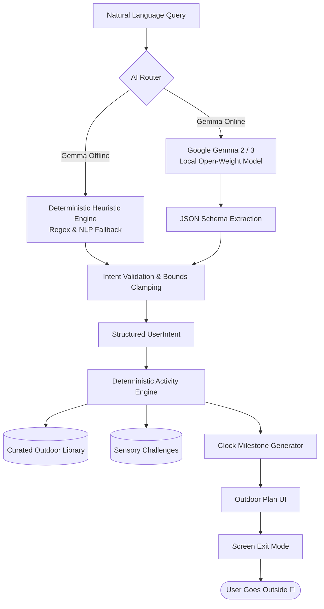
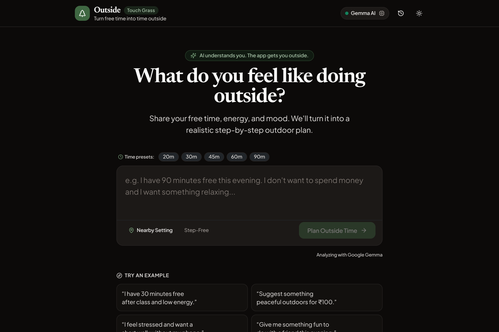
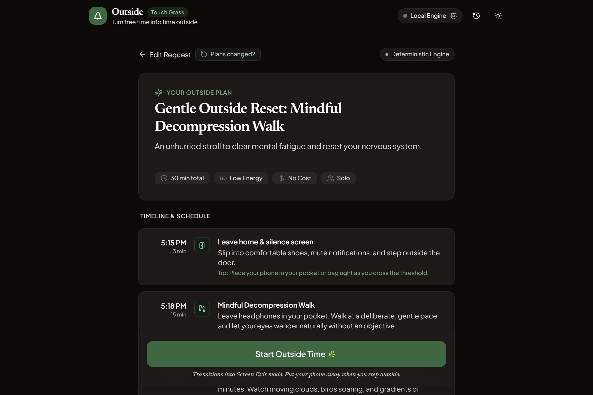
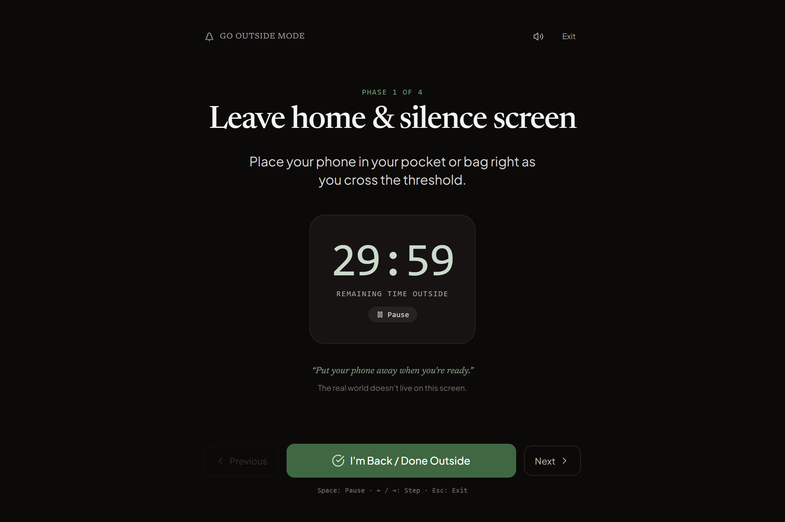

# Outside

> **Turn free time into time outside.**  
> Built for the DEV Hacktoberfest 2026 Week 1 Challenge: **“Touch Grass.”**

[](https://render.com/deploy?repo=https://github.com/tribhu05/outside)

---

## Why?

We live in a world where modern technology is engineered to trap our attention inside glowing rectangles. Even "wellness" and "habit" apps frequently demand endless daily logging, notifications, and screen time.

**Outside** takes the opposite approach. Its explicit measure of success is **how quickly you put your phone away and step into the open air**.

---

## The Idea

> **“AI understands you. The app gets you outside.”**

You tell Outside what you need in natural, everyday language:

> *“I have 90 minutes free this evening. I don't want to spend money and I want something relaxing.”*

An open-weight model—**Google Gemma**—interprets your natural language, energy level, budget, and mood into structured parameters. Then, a deterministic **Outdoor Activity Engine** calculates a realistic, step-by-step outdoor plan with real-world clock timestamps, sensory challenges, and a distraction-free screen exit mode.

---

## Key Features

1. **Natural-Language Intent Input**: Speak or type naturally about your free time, emotional state, budget, or companions:
   - *“I have 30 minutes free after class and low energy.”*
   - *“Suggest something peaceful outdoors for ₹100.”*
   - *“I feel stressed and want a short walk without my phone.”*
   - *“Give me something fun to do with a friend this evening.”*
   - *“I have 90 minutes free this evening. I don't want to spend money and I want something relaxing.”*
2. **Deterministic Outdoor Plan Generator**: Calculates a realistic timeline with real-world clock times (e.g., *6:00 PM — Leave home*, *6:05 PM — 25-minute relaxed walk*, *6:30 PM — Park bench reflection*, *6:45 PM — 5-senses observation*, *7:10 PM — Stroll back*). Includes:
   - **Checklist & Items to Bring**: Water bottle, layers, pocket notebook, or walking shoes.
   - **Gentle Safety Guidance**: Hydration reminders, daylight awareness, and situational orientation.
   - **Sheltered Weather Alternatives**: Covered porches, gazebo lookouts, or canopy paths for rainy or chilly days.
   - **Step-Free Mobility Support**: Dedicated step-free toggle and automatic matching for flat, paved, or bench-friendly routes.
3. **“Challenge Me” Sensory Micro-Challenges**: Concrete exercises designed to stimulate sensory awareness and break digital habits (e.g. *5-Senses Grounding*, *Canopy & Cloud Gaze*, *Three Leaf Architectures*, *Five Minutes Without Headphones*). Each challenge features a suggested duration (`~2m`), physical action, and reflection prompt.
4. **Screen Exit Mode ("GO OUTSIDE")**: Once you begin your session, the interface collapses into a minimalist, high-contrast screen with a calm timer, one simple instruction, and a single core reminder:
   > *“Put your phone away when you're ready. The real world doesn't live on this screen.”*
   - High-contrast, battery-friendly ambient interface.
   - Keyboard navigation (`Space` to pause/resume countdown, `←` / `→` for phase navigation, `Esc` to return).
   - Soothing singing bowl chime audio on departure and completion.
5. **Mindful Reflection**: When you return, Outside welcomes you back with a gentle mood check-in (😊 *Better*, 😌 *Relaxing*, ⚡ *Energizing*, 😐 *Okay*, 😴 *Still tired*), an outing completion selector (*Full outing* vs. *Partial*), next-time pacing preference (*Similar pace*, *Different*, *Surprise me*), and an optional reflection log.
6. **Local-First History & Wellbeing Stats**: Tracks cumulative outdoor minutes, outings, and mood reset rate over time—saved 100% locally in your browser with full data sanitization and a one-click log clear option.
7. **Optional Setting Picker**: Choose nearby spaces (park, neighborhood, quiet bench, trail, waterfront) without mandatory GPS or location tracking.
8. **“Plans Changed?” Real-World Mission Adaptation**: Real life happens—it starts raining, a meeting gets rescheduled to leave you with only 15 minutes, or you feel exhausted. One click opens the adaptation modal to instantly recalibrate your mission (adjusting duration to 15–60 min, swapping exposed trails for covered porch/canopy observations, filtering for step-free routes, or switching to solo/social mode) without starting over.

---

## How AI Works

Outside uses open-weight AI (**Google Gemma 2 / Gemma 3**) strictly where language models excel: **unstructured human language understanding**.

### The Flow:
```
User Natural Language
        ↓
Google Gemma (Open-Weight Model)
        ↓
Structured User Intent (JSON)
        ↓
Validation & Boundary Normalization
        ↓
Deterministic Outdoor Activity Engine
        ↓
Realistic Step-by-Step Outdoor Plan
        ↓
Screen Exit Mode ("Go Outside")
```

Gemma receives instructions to output a strict JSON payload:
```json
{
  "durationMinutes": 90,
  "energyLevel": "low",
  "mood": "stressed",
  "budget": "free",
  "activityPreference": "walking",
  "socialPreference": "solo",
  "locationPreference": "park",
  "timeOfDay": "evening"
}
```

The validated intent is then handed over to the deterministic engine to construct the physical schedule.

---

## Why Not Just Use a Chatbot?

Chatbots frequently:
- Hallucinate unrealistic outdoor itineraries or dangerous timeframes.
- Write chat walls of text that keep you reading on your screen.
- Encourage multi-turn conversation loops that defeat the purpose of stepping outdoors.

By keeping the AI focused exclusively on **intent extraction** while deterministic code governs **activity matching and milestone timing**, Outside guarantees reliability, safety, and an immediate exit from the screen.

---

## Local-First & Privacy Guarantee

- **Zero Cloud Analytics**: No third-party trackers, no behavioral telemetry, and no ad scripts.
- **Local AI by Default**: Connects directly to your local Gemma instance over `localhost`. No private conversations or mental states are dispatched to proprietary cloud servers.
- **On-Device Storage**: Your completed sessions and reflection notes live exclusively in your browser's `localStorage`. You can export your data to JSON or clear it at any time.

---

## AI Architecture



---

## Running Gemma Locally

Outside connects out of the box to any local OpenAI-compatible inference server running Gemma.

### Using Ollama:
1. Install [Ollama](https://ollama.com/).
2. Run Google Gemma in your terminal:
   ```bash
   ollama run gemma2:2b
   ```
   *(Or for higher precision: `ollama run gemma2:9b`)*
3. That's it! Outside automatically connects to `http://localhost:11434/v1/chat/completions`.
4. Open the **AI Engine & Privacy** modal (`Gemma / Heuristic Architecture` in the footer) and click **Test Connection** to verify live model responsiveness and roundtrip latency (e.g. `Connected (1253ms) — gemma2:2b verified`).

### Local Heuristic Fallback (Zero Setup)
If Gemma is not running or takes longer than the 30-second local threshold, **Outside does not crash or fake AI responses**. It automatically activates its internal deterministic heuristic parser and displays a truthful `Local Engine` badge with fallback diagnostics.

---

## Setup & Development

### Prerequisites
- Node.js 18+ (tested on Node v20 & v24)
- npm or yarn

### Installation
```bash
# Clone the repository
git clone https://github.com/tribhu05/outside.git
cd outside

# Install dependencies
npm install

# Start local development server
npm run dev
```
Open `http://localhost:5173` in your browser.

### Running Tests
Outside includes both automated unit tests (Vitest) and full real-browser end-to-end tests (Puppeteer in Chrome):

```bash
# Run unit & deterministic engine test suites (53/53 passing)
npm test

# Run real Chrome browser end-to-end user journey tests (52/52 passing)
npm run test:e2e

# Run TypeScript typecheck
npm run lint
```

### Production Build
```bash
npm run build
```

---

## Configuration

You can configure the AI endpoint via environment variables or directly inside the in-app **AI Engine & Privacy** modal.

Copy `.env.example` to `.env`:
```env
VITE_GEMMA_API_URL=http://localhost:11434/v1/chat/completions
VITE_GEMMA_MODEL=gemma2:2b
```

---

## Screenshots

| 1. Natural Language Input | 2. Structured Outdoor Plan |
|---|---|
|  |  |

| 3. Minimal Screen Exit Mode | 4. Reflection & Log |
|---|---|
|  |  |

---

## Documentation

Detailed specifications are available in the [`/docs`](docs/) directory:
- [`docs/architecture.md`](docs/architecture.md): Deep-dive into technical architecture and state flow.
- [`docs/demo-script.md`](docs/demo-script.md): Step-by-step 2-minute walkthrough guide for evaluators.
- [`docs/challenge-notes.md`](docs/challenge-notes.md): Official submission notes for DEV Hacktoberfest 2026.

---

## Contributing

Contributions from the open-source community are warmly welcomed!
1. Fork the repository.
2. Create your feature branch (`git checkout -b feature/mindful-challenge`).
3. Commit your changes (`git commit -m 'Add new acoustic observation challenge'`).
4. Ensure all tests pass (`npm test && npm run build`).
5. Push to your branch and open a Pull Request.

---

## License

Released under the [MIT License](LICENSE).
