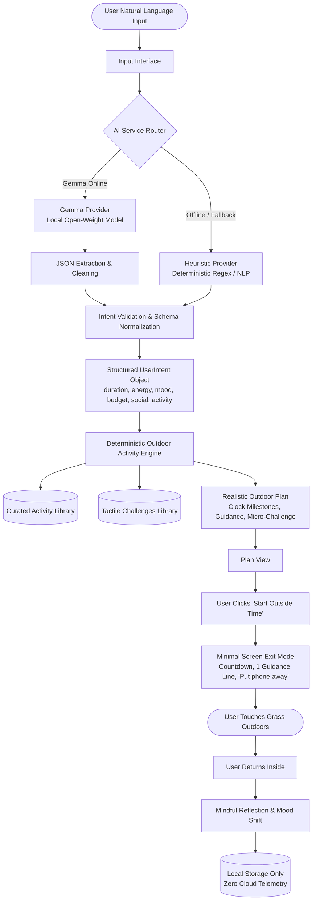

# Outside Architecture Specification

## Philosophy

Most modern AI apps are designed to maximize engagement, retention, and time spent looking at a screen. **Outside** does the exact inverse: its explicit success metric is minimizing screen time and maximizing time spent in the open air.

> **“AI understands you. The app gets you outside.”**

---

## High-Level Architecture

---

## Core Components

### 1. Natural Language Extraction (`src/ai/`)
- **`GemmaProvider`**: Connects via OpenAI-compatible endpoints to Google Gemma 2 / Gemma 3 instances (e.g., Ollama at `http://localhost:11434/v1/chat/completions` or LM Studio). Uses structured system instructions to isolate human intent parameters without hallucinating plans.
- **`HeuristicProvider`**: Fast, zero-dependency, local regex and deterministic NLP parser. Catches natural duration strings (`"90 minutes"`, `"1.5 hours"`, `"half an hour"`), budget constraints (`"free"`, `"no money"`), energy states (`"tired"`, `"exhausted"`, `"high energy"`), moods, and social arrangements.
- **`IntentValidator`**: Validates parsed tokens into strict boundaries (e.g. durations clamped between 15 and 240 minutes, normalized enum fields, fallback defaults).
- **`AIService`**: Orchestrates providers, transparently falling back to the heuristic engine if Gemma is offline, preventing broken application states.

### 2. Deterministic Activity Engine (`src/planner/`)
- **`activityDatabase.ts`**: Curated repository of physical outdoor activities with attributes covering minimum/maximum durations, energy requirements, social preferences, weather/time suitability, and preparation checklists.
- **`engine.ts`**: Scoring algorithm that evaluates candidate activities against the structured intent and maps them into a clock-based schedule (e.g. 6:00 PM departure, 6:05 PM outbound walk, 6:35 PM anchor activity, 7:00 PM sensory pause, 7:15 PM return walk).
- **`challenges.ts`**: Micro-challenges engineered to break phone habits and stimulate sensory grounding (5-senses grounding, canopy gaze, botanical leaf observation, sound horizon).

### 3. Screen Exit Mode (`src/components/ScreenExitMode.tsx`)
- High-contrast, minimal distraction mode.
- Large remaining time countdown.
- Exactly one primary instruction for the active phase.
- Core grounding message: *"Put your phone away when you're ready. The real world doesn't live on this screen."*
- Web Audio API singing bowl chimes for peaceful milestone transitions without downloading external audio files.

### 4. Local Reflection & Storage (`src/services/storage.ts`)
- Preserves user history entirely on-device via `localStorage`.
- Tracks wellbeing delta: mood before vs. mood after, actual outdoor minutes, and challenge completion rate.
- Provides one-click JSON export.
