# What if AI helped you put your phone down? 🌿 Meet Outside

*This is a submission for the [Hacktoberfest Open-Source AI Challenge Week 1: Touch Grass](https://dev.to/challenges/hacktoberfest-week1-2026-10-05)*

---

## 🌿 What I Built

Most software products share a single unspoken business goal: **maximize screen time**. They want you scrolling feeds, chatting with LLMs, tapping notifications, and maintaining daily digital streaks.

Even modern "wellness" and "mindfulness" apps fall into this trap. They ask you to log into a dashboard, stare at an OLED screen for 20 minutes reading articles about forest bathing, or carry on multi-turn conversations with generic chatbots that keep you typing indoors.

I built **[Outside](https://github.com/tribhu05/outside)** around the exact opposite philosophy:

> **“AI understands you. The app gets you outside.”**

**Outside** is an open-source outdoor activity companion powered by local open-weight AI (**Google Gemma 2**). Its explicit success metric is **how quickly you put your phone away and step into the open air.**

```
Tell Outside how you feel ➔ Receive one clock-accurate mission ➔ Put phone away ➔ Experience the real world ➔ Reflect
```

Rather than an endless chat loop, Outside takes one freeform sentence, extracts your real-world constraints using Google Gemma, constructs a clock-accurate outdoor itinerary with sensory grounding challenges, and transitions into a distraction-free **Screen Exit Mode** with pure Web Audio harmonic chimes.

---

## 🚀 Live Demo & Source Code

- 🌐 **Live Web Application**: [https://outside-lmth.onrender.com](https://outside-lmth.onrender.com)
- 🎬 **Watch the 2-Minute Demo Video**:

- 💻 **GitHub Repository**: [https://github.com/tribhu05/outside](https://github.com/tribhu05/outside) *(MIT Licensed)*
- 📄 **Judges Walkthrough Script**: [docs/demo-script.md](https://github.com/tribhu05/outside/blob/master/docs/demo-script.md)

---

## 📸 Visual Product Tour

### 1. From Natural Language to a Real-World Clock Plan

| **1. Natural-Language Input** | **2. Structured Plan Intent** |
| :---: | :---: |
|  |  |
| *Type constraints freely: time, budget, and energy* | *Parsed intent pills: 30 min, Moderate Energy, Free, Solo* |
| **3. Clock-Accurate Timeline** | **4. Minimalist Screen Exit Mode** |
|  |  |
| *Verified milestones calculated against current time* | *Ambient timer with 432 Hz singing bowl chime* |

---

### 2. Guided Outdoor Milestones (The Phone-Free Experience)

Once you cross the threshold and step outside, Outside delivers calm, distraction-free milestone prompts:

| **Phase 2: Outbound Stroll** | **Phase 3: Sensory Challenge** | **Phase 4: Return Leg** |
| :---: | :---: | :---: |
|  |  |  |
| *"Walk slowly enough that you could speak without losing breath"* | *"Observation pause: Locate 3 distinctly different leaf shapes"* | *"Notice how your mind feels now compared to when you left"* |

---

### 3. Mindful Return & 100% On-Device Wellbeing History

When you step back inside, Outside welcomes you back, tracks your mood shift, and saves everything locally:

| **Mindful Reflection Modal** | **On-Device Outside Log** |
| :---: | :---: |
|  |  |
| *Log how you feel (😊 Better) & check off outdoor challenge* | *100% on-device localStorage with 1-click JSON export* |

---

## ✨ Core Experience & Features

### 1. Freeform Natural-Language Planning
Tell Outside your current real-world constraints in messy, human language:
- *“I have 30 minutes free after class.”*
- *“I feel stressed after coding all day and want a 25-minute brisk walk.”*
- *“Suggest a peaceful morning outing with a friend for ₹0.”*

Zero multi-turn chat traps. Outside extracts your constraints in a single turn and builds your itinerary immediately.

### 2. Clock-Accurate Timeline & Packing Guidance
Instead of vague advice like *"go for a walk sometime"*, Outside generates a deterministic, verified schedule mapped to your real-world clock:
```
7:12 PM — Leave home & silence screen (Place phone in pocket)
7:15 PM — 15-minute Mindful Decompression Walk
7:30 PM — Observation pause: Find Three Leaf Shapes
7:35 PM — Easy stroll back
```
It includes a personalized preparation checklist and tailored safety reminders.

### 3. Tactile "Challenge Me" Sensory Micro-Challenges
To prevent mindlessly opening social feeds while walking, Outside incorporates tactile exercises designed to stimulate sensory grounding and break digital autopilot:
- **Three Leaf Architectures**: Locate 3 distinctly shaped leaf patterns, shapes, or bark textures on your path without picking them.
- **5-Senses Grounding**: Pause and notice 5 things you see, 4 textures you can touch, 3 sounds you hear, 2 outdoor scents, and 1 physical sensation.
- **Canopy & Cloud Gaze**: Look straight up into the tree canopy or moving clouds for 2 uninterrupted minutes.
- **Acoustic Horizon (No Headphones)**: Listen past near traffic to find the farthest ambient sound in nature.

### 4. Distraction-Free Screen Exit Mode ("GO OUTSIDE")
Once you click **“Start Outside Time 🌿”**, the entire website sheds cards, menus, and web clutter:
- Ambient, high-contrast, battery-friendly countdown timer.
- Single active milestone guidance line.
- **Pure Web Audio API 432 Hz Singing Bowl Chime**: Synthesized harmonic frequencies provide gentle transition bells upon departure and completion—requiring zero external audio downloads.
- Full keyboard accessibility (`Space` to pause/resume, arrow keys to navigate milestones, `Esc` to return).
- Screen Wake Lock API integration to keep guidance visible without turning off your display while preparing.

### 5. "Plans Changed?" Dynamic Real-World Recalibration
Real life doesn't always go according to plan. If weather turns, energy drops, or rain starts pouring, click **"Plans changed?"** to adapt the active mission on the fly without starting over:
- **Available Time**: Quickly adjust to 15m, 30m, 45m, or 60m.
- **Energy Level**: Switch between Exhausted / Low, Moderate, or Energized.
- **Weather & Shelter**: Swaps open nature trails for covered porches, gazebo lookouts, or sheltered canopy paths.
- **Step-Free Accessibility**: Filters for flat, paved, stair-free routes with nearby seating.
- **Social Mode**: Toggles between quiet solo decompression and walking with friends.

### 6. Mindful Return & 100% On-Device Wellbeing Log
When you return, Outside welcomes you back:
- Record your mood shift (😊 *Better*, 😌 *Relaxing*, ⚡ *Energizing*, 😐 *Okay*, 😴 *Still tired*).
- Check off your sensory challenge and note what you observed.
- Cumulative outdoor time tracking and mood reset rate (e.g. *100% of outings improved mood*).
- **100% On-Device**: All session logs reside exclusively in browser `localStorage`. Includes 1-click JSON export and clear data options.

---

## 🏗️ How I Built It

Outside is built with **React 19**, **TypeScript 5.7**, **Vite 6**, and **Tailwind CSS 3.4**, with an architectural design that rigorously separates **unstructured natural language understanding** from **deterministic itinerary calculation**.

### System Architecture

```mermaid
flowchart TD
    subgraph Client["Client Browser (React 19 + TypeScript)"]
        User["User Natural-Language Input\n('30 minutes free after class')"] --> Router{"AI Service Router\n(aiService.ts)"}
        
        Router -->|"Gemma Online"| GP["Gemma Provider\n(gemmaProvider.ts)"]
        Router -->|"Ollama Offline / Fallback"| HP["Deterministic Heuristic Parser\n(heuristicProvider.ts)"]
        
        GP -->|"Local HTTP POST"| Ollama["Local Ollama Runtime\n(localhost:11434)"]
        Ollama --> Gemma["Google Gemma 2\n(gemma2:2b)"]
        Gemma -->|"Structured JSON"| Parse["JSON Cleaner & Normalizer"]
        
        Parse --> Valid["Intent Validator & Bounds Clamper\n(validator.ts)"]
        HP --> Valid
        
        Valid --> Intent["Typed UserIntent Schema\n(duration, energy, mood, budget, social)"]
        Intent --> Engine["Deterministic Activity Engine\n(engine.ts)"]
        
        Engine --> Lib[("Curated Activity Library")]
        Engine --> Chal[("Sensory Challenges Library")]
        
        Engine --> Plan["Clock-Accurate Outdoor Plan"]
        Plan --> UI["Plan View & Micro-Challenges"]
        
        UI -->|"Conditions Shift"| Modal["'Plans Changed?' Modal"]
        Modal -->|"Dynamic Recalibration"| Engine
        
        UI -->|"Start Outside Time"| ScreenExit["Screen Exit Mode\n('Go Outside')"]
        ScreenExit --> Out["User Steps Outdoors & Pockets Phone 🌿"]
        Out --> Reflection["Mindful Return & Mood Delta"]
        Reflection --> Storage[("Browser localStorage Only\n(Zero Cloud Trackers)")]
    end
```



---

### The Code That Matters

#### 1. Constrained Gemma 2 Intent Extraction
Rather than letting the LLM invent itineraries, we instruct Google Gemma (`gemma2:2b`) to act exclusively as a semantic parameter extractor into strict typed JSON:

```typescript
// src/ai/gemmaProvider.ts
const systemPrompt = `You are an AI that extracts structured user intent for outdoor plans. 
You do NOT write the activity plan yourself. 
Your job is ONLY to extract the user's intent into a clean JSON object conforming strictly to this format:

{
  "durationMinutes": number, // total available time in minutes (15 to 240)
  "energyLevel": "low" | "moderate" | "high",
  "mood": "stressed" | "tired" | "restless" | "reflective" | "curious" | "social" | "neutral",
  "budget": "free" | "low-cost",
  "activityPreference": "walking" | "nature-observation" | "mindfulness" | "reading" | "sketching" | "jogging" | "cycling" | "exploration" | "any",
  "socialPreference": "solo" | "friends" | "partner" | "family" | "any",
  "locationPreference": "park" | "neighborhood" | "water" | "trail" | "quiet-bench" | "campus" | "garden" | "any",
  "timeOfDay": "morning" | "afternoon" | "sunset" | "evening" | "night"
}

Output ONLY valid raw JSON. Do not include markdown backticks or explanations.`;
```

#### 2. Deterministic Clock Timeline Generation
Our activity engine takes the validated intent and creates a reliable, clock-based milestone schedule with buffer times:

```typescript
// src/planner/engine.ts
export function buildOutdoorPlan(intent: UserIntent, now = new Date()): OutdoorPlan {
  const ranked = rankActivities(intent);
  const primary = ranked[0].activity;
  
  const milestones: PlanMilestone[] = [];
  let elapsed = 0;
  
  // Phase 1: Departure & Disconnect
  milestones.push({
    id: 'depart',
    time: formatClockTime(now, elapsed),
    durationMinutes: 3,
    title: 'Leave home & silence screen',
    description: 'Slip into comfortable shoes, mute notifications, and step outside the door.',
    type: 'prep'
  });
  elapsed += 3;
  
  // Phase 2: Outbound Stroll
  const travelMinutes = Math.max(10, Math.round((intent.durationMinutes - 15) * 0.5));
  milestones.push({
    id: 'outbound',
    time: formatClockTime(now, elapsed),
    durationMinutes: travelMinutes,
    title: `Mindful Decompression Walk`,
    description: `Walk at a deliberate, gentle pace and let your eyes wander naturally.`,
    type: 'travel'
  });
  // ... anchor activity, sensory observation pause, and return stroll
}
```

#### 3. Pure Web Audio Harmonic Singing Bowl Synthesizer
Zero MP3 or WAV files to download. Outside synthesizes a 432 Hz fundamental tone with physical acoustic overtones directly in the browser:

```typescript
// src/utils/audio.ts
export function playSingingBowlChime(fundamentalFreq = 432) {
  const ctx = getAudioContext();
  if (!ctx) return;
  const now = ctx.currentTime;
  
  // Fundamental tone + gentle harmonising overtones
  const freqs = [fundamentalFreq, fundamentalFreq * 1.5, fundamentalFreq * 2.02, fundamentalFreq * 2.76];
  const gains = [0.4, 0.2, 0.1, 0.05];

  freqs.forEach((freq, i) => {
    const osc = ctx.createOscillator();
    const gain = ctx.createGain();

    osc.type = 'sine';
    osc.frequency.setValueAtTime(freq, now);
    gain.gain.setValueAtTime(0, now);
    gain.gain.linearRampToValueAtTime(gains[i], now + 0.04); // Gentle attack
    gain.gain.exponentialRampToValueAtTime(0.0001, now + 3.2); // 3.2s peaceful decay

    osc.connect(gain);
    gain.connect(ctx.destination);
    osc.start(now);
    osc.stop(now + 3.3);
  });
}
```

---

## 🧪 Rigorous Automated Testing

Outside is backed by a comprehensive testing suite with **105 automated checks passing**:

```bash
npm test        # 53 Vitest unit & integration tests passing
npm run test:e2e # 52 Puppeteer browser end-to-end tests passing
npm run lint    # 0 TypeScript type errors
```

| Test Suite | Tests | What Is Verified |
| :--- | :---: | :--- |
| **Unit & Integration** | **53 / 53** | Intent boundary validation, regex duration extraction, AI health checks, latency calculation, Markdown JSON cleaning, fallback switching, and activity ranking. |
| **Browser E2E (Puppeteer)** | **52 / 52** | Real Chrome journey: homepage load, 30m plan generation, challenge shuffle, "Plans Changed?" dynamic recalibration, Screen Exit Mode timer countdown, audio chime execution, reflection save, and localStorage persistence. |

---

## 🔓 Why Open Innovation Matters

The DEV challenge prompt asks: *“Tell us why open innovation matters for what you built. Where did your open-based approach work better than a closed one?”*

Here is why Outside could **only** be built with open innovation:

### 1. Privacy for Vulnerable Mental Health States
When someone opens Outside, their prompts are deeply personal and vulnerable:
> *“I'm having a panic attack, I have ₹0, and I need somewhere to breathe.”*  
> *“I've been staring at a computer screen for 10 hours and my head hurts.”*

Sending these intimate psychological states to proprietary cloud LLM APIs means logging your mental health and location habits on centralized corporate servers for model retraining or advertising profiles. With **Google Gemma 2 running locally via Ollama**, **zero tokens, zero telemetry, and zero prompt text ever leave your computer**.

### 2. Eliminating AI Hallucination via Architectural Separation
If you prompt a closed cloud chatbot: *"Plan an outdoor walk for me"*, it hallucinates fake trail lengths, fabricates impossible transit schedules, or writes a 1,000-word essay that keeps you glued to your phone reading.

By using open-weight Gemma strictly as a parameter extractor and passing the parsed tokens to our open-source deterministic engine, we get the best of both worlds: **human empathy from the language model, and mathematical precision from deterministic code.**

### 3. Backcountry & Trail Offline Resilience ($0 Cost)
The best places to touch grass—mountain trails, nature reserves, and dense botanical gardens—often have weak or nonexistent cellular service. Because Outside operates completely on-device with zero cloud dependencies, it works anywhere in the world and costs **$0 in recurring API fees**.

### 4. Zero-Crash Deterministic Fallback
If a user doesn't have Ollama installed or is browsing on mobile, Outside doesn't throw an error or fake an AI response. Our internal heuristic parser takes over smoothly with an honest `Local Engine` badge. Open-source means transparency: you always know exactly which engine processed your request.

---

## 🌿 We Touched Grass: The 25-Minute Sunset Field Test

*Bonus Challenge Requirement: Take it outside, use it, and tell us how it went!*

Yesterday evening at 6:15 PM, after spending hours debugging TypeScript types and CSS edge cases, my eyes were stinging from monitor glare. My natural instinct was to sit on the couch and doomscroll tech feeds.

Instead, I opened **Outside** and entered:
> **“I have 25 minutes before dusk. I'm mentally drained and have no money. Give me something calming.”**

Within two seconds, Outside generated a focused mission:
- **Timeline**: 6:17 PM departure ➔ 6:22 PM quiet outbound walk to the neighborhood tree line ➔ 6:30 PM bench pause ➔ 6:37 PM return.
- **Sensory Challenge**: *Three Leaf Shapes* (find 3 distinctly shaped leaf patterns or bark textures).
- **Items to Bring**: A light jacket and keys. Leave headphones behind.

I clicked **“Start Outside Time 🌿”**. The UI cleared into a peaceful countdown. The 432 Hz singing bowl chime resonated, and I slipped my phone into my jacket pocket.

**What happened next:**
For 25 minutes, I didn't check a single notification, Slack ping, or git commit. I noticed the cool autumn evening breeze, the coarse texture of eucalyptus bark, the silhouette of birds heading to roost against the orange twilight, and the smell of damp earth.

When I stepped back through the door at 6:42 PM, I tapped **“I'm Back / Done Outside”**. I rated my mood shift from **Exhausted** to **😌 Relaxed & Centered**, and checked off the grounding challenge. 

That 25-minute walk broke my digital tunnel vision far better than any meditation app with streaks ever could.

---

## 🏆 Prize Categories

### 1. Best Use of Gemma ($200)
Outside is built around **Google Gemma 2 (`gemma2:2b`)** running locally through Ollama:
- **Constrained Schema Extraction**: Enforces strict JSON schema extraction, converting natural language into typed `UserIntent` boundaries.
- **Resilient Client Architecture**: Custom `GemmaProvider` featuring a realistic 30-second timeout accommodating consumer CPU/GPU cold starts.
- **Live Health Diagnostics**: Live in-app **Test Connection** ping sending minimal 5-token verification requests (`max_tokens: 5`) and reporting real-time roundtrip latency (e.g. `Connected (1253ms) — gemma2:2b verified`).
- **Markdown Stripping & Schema Repair**: Custom parser handles and cleans model conversational preambles and backtick blocks cleanly.

### 2. Best Use of Render ($200)
Outside is deployed and hosted on **Render** as a high-performance static web service:
- **Production URL**: [https://outside-lmth.onrender.com](https://outside-lmth.onrender.com)
- **Declarative Infrastructure**: Configured via repository [`render.yaml`](https://github.com/tribhu05/outside/blob/master/render.yaml):
  ```yaml
  services:
    - type: web
      name: outside
      runtime: static
      buildCommand: npm install && npm run build
      staticPublishPath: ./dist
      headers:
        - path: /*
          name: X-Frame-Options
          value: SAMEORIGIN
      routes:
        - type: rewrite
          source: /*
          destination: /index.html
  ```
- **Automated CI/CD**: Clean build artifact compilation via Vite 6 and Node 20 runtime on every push to `master`.

### 3. Overall Winner ($250)
Outside embodies the **“Touch Grass”** theme at its philosophical and technical core: an AI application that proves the greatest achievement of modern software is sometimes knowing when to get out of the way.

---

## 🗺️ What's Next for Outside

- **Voice-Narrated Departures**: Optional 30-second audio departure briefing before the screen locks.
- **Printable Pocket Mission Cards**: One-click thermal-printer or postcard layout for 100% phone-free outdoor excursions.
- **Offline GPX / GeoJSON Overlays**: OpenStreetMap-based step-free trail overlays with zero third-party location tracking.
- **Seasonal Phenology Cues**: Automated nature observation prompts based on regional solstice and migration calendars.

---

## 💚 Closing Thoughts

In an attention economy that treats human minutes as advertising inventory, **Outside is proud to be software you close.**

Technology shouldn't trap us in digital boxes. When engineered with restraint and powered by open-weight AI, it can be the gentle nudge that gets us through the front door.

Go ahead: tell it what you need, get your plan, pocket your phone, and go touch grass. 🌿

- 🌐 **Try it Live**: [outside-lmth.onrender.com](https://outside-lmth.onrender.com)
- 💻 **Star on GitHub**: [github.com/tribhu05/outside](https://github.com/tribhu05/outside)
- 🎬 **Watch the Demo**: [YouTube Walkthrough](https://youtu.be/umWsHyiBCoo)

*Built by Tribhuwan S. (@t7b5u) for the DEV Hacktoberfest 2026 Challenge.*
