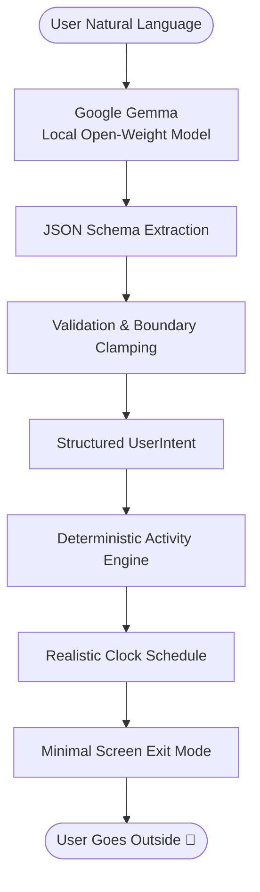

# Outside: Turn Free Time into Time Outside 🌿

*Built for DEV Hacktoberfest 2026 — Week 1: “Touch Grass”*

Most software products share a single unspoken business goal: **maximize screen time**. They want you scrolling feeds, chatting with LLMs, tapping notifications, and tracking habits.

Even "wellness" and "mindfulness" apps commit this sin. They encourage you to stare at a blue-light screen for 20 minutes reading articles about nature, or they introduce multi-turn chatbots that keep you typing endlessly indoors.

We built **[Outside](https://github.com/your-username/outside)** around the exact opposite philosophy:

> **“AI understands you. The app gets you outside.”**

The explicit success condition of Outside is **how quickly you put your phone away and step into the fresh air**.

---

## The Core Concept

You tell Outside what you need in everyday, messy human language:

> *“I have 90 minutes free this evening. I don't want to spend money and I want something relaxing.”*  
> *(or “I have 45 minutes and need to clear my head.”)*

An open-weight model—**Google Gemma**—interprets your natural language, energy level, budget, and mood into structured parameters.

Then, a deterministic **Outdoor Activity Engine** calculates a realistic, step-by-step outdoor plan with real-world clock timestamps, sensory challenges, and a distraction-free screen exit mode.

```
🌿 YOUR OUTSIDE PLAN

6:00 PM — Leave home & silence screen
6:05 PM — 25-minute relaxed outbound stroll
6:30 PM — Sit somewhere peaceful (Park bench reflection)
6:45 PM — Try the 5-senses observation activity
7:10 PM — Easy stroll back
7:30 PM — Return refreshed
```

---

## Why Open-Weight AI (Google Gemma)?

We chose **Google Gemma 2 / 3** for two fundamental reasons:

### 1. Privacy for Vulnerable Human States
When someone asks for an outdoor break, they often share vulnerable context: *"I'm completely burnt out,"* *"I feel overwhelmed and anxious,"* or *"I have $0 to spend and need quiet."* 

Sending this intimate mental state to centralized proprietary cloud servers feels invasive. With Gemma running locally (via [Ollama](https://ollama.com/) or LM Studio), **not a single token or telemetry byte leaves your device**.

### 2. Separation of AI Intent vs. Deterministic Scheduling
A classic mistake with AI apps is asking a large language model to generate the entire itinerary as freeform markdown. Chatbots hallucinate unsafe timelines, recommend impossible travel buffers, or write walls of text that keep you reading.

Outside establishes a strict architectural boundary:



Gemma is tasked **only** with parsing human intent:

```json
{
  "durationMinutes": 90,
  "energyLevel": "low",
  "mood": "stressed",
  "budget": "free",
  "activityPreference": "walking",
  "socialPreference": "solo",
  "locationPreference": "park",
  "timeOfDay": "evening"
}
```

Once validated, our deterministic engine builds the schedule. AI provides the empathy; deterministic code provides the reliability.

---

## Honest AI Fallback (No Fake Responses)

What if the user doesn't have Gemma or Ollama installed? 

Rather than breaking or faking AI responses, Outside features a built-in **Deterministic Heuristic Engine**:
- Parses durations (*“half an hour”*, *“90 mins”*, *“1.5 hours”*, *“quick walk”*)
- Detects budget constraints (*“free”*, *“broke”*, *“$0”*)
- Analyzes moods (*“stressed”*, *“clear my head”*, *“tired”*, *“active”*)
- Identifies social dynamics (*“friends”*, *“alone”*, *“partner”*)

If Gemma is offline, the interface subtly displays `Local Engine` instead of `Gemma AI`. Full transparency, zero gimmicks.

---

## Key Features Built for the Real World

### 1. “Challenge Me” Sensory Micro-Challenges
To prevent mindlessly checking social feeds while outdoors, Outside suggests tactile micro-challenges:
- **5-Senses Grounding**: Pause and notice 5 things you see, 4 textures you can touch, 3 sounds you hear, 2 outdoor scents, and 1 physical sensation.
- **Canopy & Cloud Gaze**: Look straight up into the tree canopy or sky for 2 uninterrupted minutes.
- **Three Leaf Architectures**: Locate 3 distinct leaf structures on your route without picking them.
- **Phone in Pocket**: Pocket your device for the entire duration without glancing once.

### 2. Screen Exit Mode ("GO OUTSIDE")
Once you click **“Start Outside Time 🌿”**, the entire website transforms into a calm, high-contrast, distraction-free screen:
- Large remaining time countdown.
- Exactly one primary instruction for the active phase.
- Built-in Web Audio API singing bowl chime (no external audio files to download).
- The core grounding reminder:
  > *“Put your phone away when you're ready. The real world doesn't live on this screen.”*

### 3. Mindful Return & Local Wellbeing Log
When you return, Outside welcomes you back:
- Simple check-in: 😊 *Better*, 😌 *Relaxing*, ⚡ *Energizing*, 😐 *Okay*, 😴 *Still tired*.
- Optional reflection note.
- Calculates your cumulative outdoor hours and mood reset rate (e.g., 90%+ reported feeling calmer or more energized).
- Saved 100% locally in `localStorage` with a 1-click JSON export.

---

## Under the Hood: Clean Architecture

Outside is built with **React 19**, **TypeScript**, **Tailwind CSS**, and **Vitest**:

- `src/ai/provider.ts`: Polymorphic `IntentExtractor` interface.
- `src/ai/gemmaProvider.ts`: Direct OpenAI-compatible streaming client for local Gemma 2.
- `src/ai/heuristicProvider.ts`: Zero-dependency regex & NLP parser.
- `src/ai/aiService.ts`: Fault-tolerant router with health check & auto-fallback.
- `src/planner/engine.ts`: Curated activity matching and milestone timeline generator.
- `src/utils/audio.ts`: Pure Web Audio API mindfulness bell synthesizer.

### Comprehensive Test Suite
Every critical algorithm is verified with automated tests:
```bash
npm test
# Result: 5 test files passed, 32 unit tests passed
```

---

## Running It Locally

```bash
# 1. Clone the repo
git clone https://github.com/your-username/outside.git
cd outside

# 2. Install dependencies
npm install

# 3. (Optional) Run Gemma locally in another terminal
ollama run gemma2:2b

# 4. Start the app
npm run dev
```

Open `http://localhost:5173`. Outside will automatically detect your local Gemma instance, or seamlessly use the built-in heuristic engine if Ollama is not running!

---

## Final Thoughts: The True Measure of Success

In an industry obsessed with daily active minutes and endless engagement loops, **Outside** is proud to be software you close.

Go ahead—tell it what you need, get your plan, put your phone away, and go touch grass. 🌿

---

- **GitHub Repository**: [github.com/your-username/outside](https://github.com/your-username/outside)
- **License**: MIT
